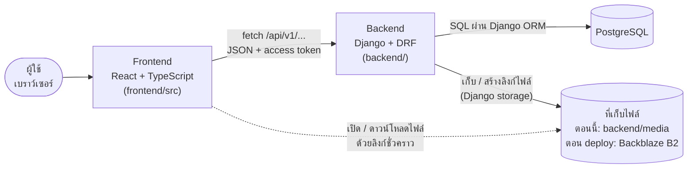
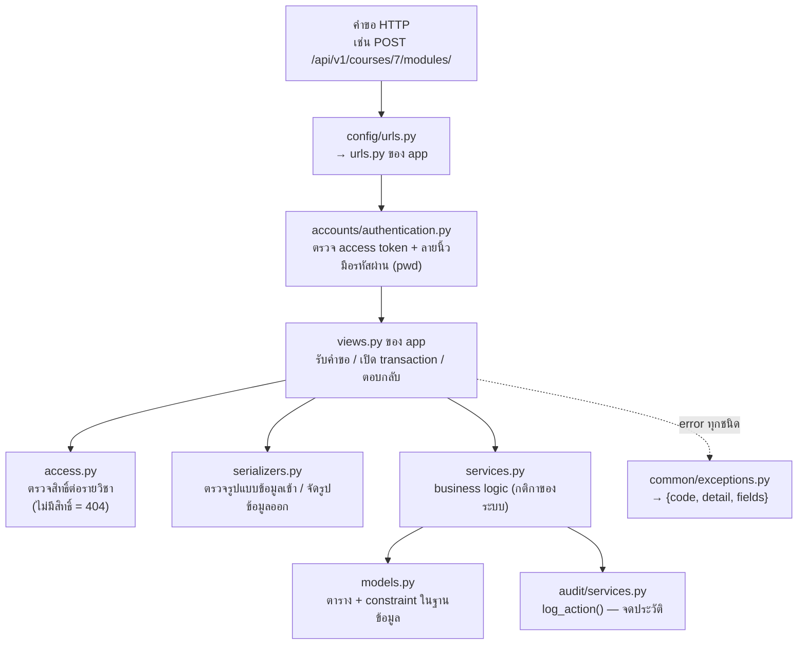
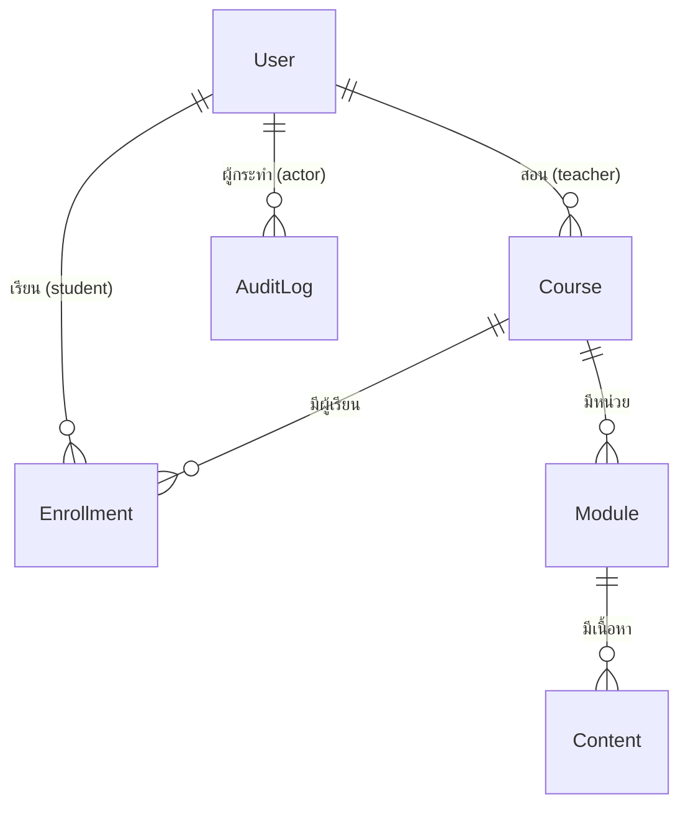
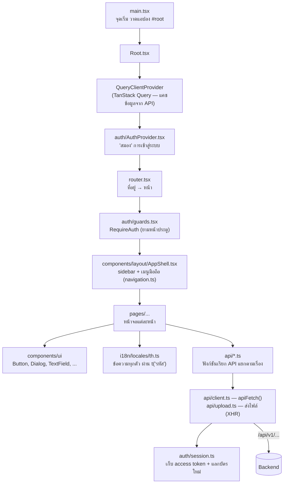
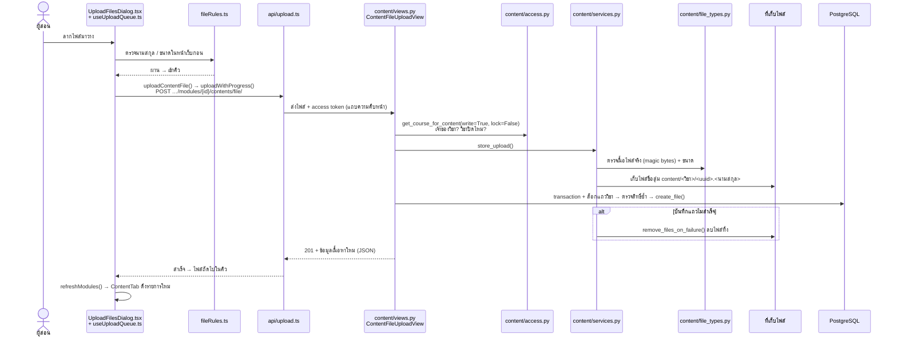
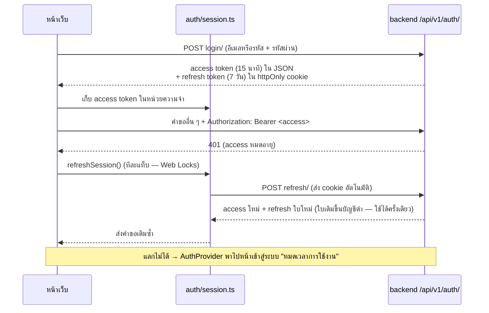
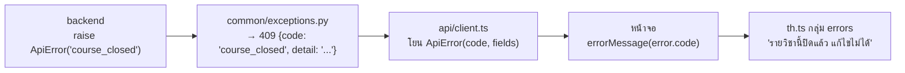

# สถาปัตยกรรมของระบบ — โค้ดแต่ละส่วนทำงานร่วมกันอย่างไร

> เขียนให้ **ผู้พัฒนาอ่านเพื่อเข้าใจภาพรวม** (และใช้ประกอบรายงานบทการพัฒนาระบบ) — อธิบาย "ใครเรียกใคร" ไม่ได้ลงรายละเอียดทุกไฟล์
> รายละเอียดรายไฟล์อยู่ใน [`PROJECT_STRUCTURE.md`](../PROJECT_STRUCTURE.md) ; รูปแบบ API อยู่ใน [`api.md`](api.md) ; ตารางฐานข้อมูลอยู่ใน [`database.md`](database.md)
> สถานะ ณ 2026-11-22 (หลังก้อน 4) — **ก้อนใหม่ที่เพิ่ม app / ชั้นใหม่ ให้อัปเดตไฟล์นี้ใน PR เดียวกัน**
> แผนภาพเขียนด้วย Mermaid — เปิดบน GitHub หรือ VS Code (ส่วนขยาย Markdown Preview Mermaid) จะเห็นเป็นรูป

---

## 1. ภาพใหญ่ — 3 ชิ้นที่คุยกัน

ระบบแบ่งเป็น **หน้าเว็บ (frontend)** ที่ทำงานในเบราว์เซอร์ กับ **หลังบ้าน (backend)** ที่ทำงานบนเซิร์ฟเวอร์ คุยกันด้วย **REST API** (ส่ง JSON ไป-กลับ) ; ข้อมูลอยู่ใน **PostgreSQL** และไฟล์อยู่ใน **ที่เก็บไฟล์**

**ทำไมเบราว์เซอร์เห็นเป็นเว็บเดียวกัน (origin เดียว)**
- ตอนพัฒนา: เปิด `http://localhost:5180` (Vite) → คำขอที่ขึ้นต้น `/api` และ `/media` ถูก **proxy ของ Vite** (`frontend/vite.config.ts`) ส่งต่อไป Django ที่พอร์ต 8008
- ตอน deploy: Django ส่งหน้าเว็บที่ build แล้วเอง (service เดียวบน Render)
- ผลคือ cookie ของ refresh token ทำงานปกติ และไม่ต้องตั้ง CORS

---

## 2. Backend — ชั้นต่าง ๆ ของ 1 คำขอ

ทุก app ใน backend เขียนแบบเดียวกัน: คำขอเข้ามา → หาเส้นทาง → ตรวจตัวตน → ตรวจสิทธิ์ต่อรายวิชา → ทำงาน → ตอบ JSON

| ชั้น | ไฟล์ | หน้าที่ | ตัวอย่าง |
|---|---|---|---|
| เส้นทาง | `config/urls.py` + `<app>/urls.py` | จับคู่ที่อยู่ → view | `/api/v1/courses/<id>/modules/` → `content.views.ModuleListView` |
| ตรวจตัวตน | `accounts/authentication.py` | อ่าน access token, ปฏิเสธบัตรที่ออกก่อนเปลี่ยนรหัสผ่าน | ตั้งเป็นค่าเริ่มต้นใน `settings.REST_FRAMEWORK` ใช้กับทุก API |
| view | `<app>/views.py` | รับคำขอ, เรียกชั้นอื่น, เปิด `transaction.atomic()`, ตอบ | `ContentFileUploadView.post()` |
| สิทธิ์ | `academics/access.py`, `content/access.py`, `accounts/permissions.py` | ตรวจว่าผู้ใช้ทำกับรายวิชานี้ได้ไหม | `get_managed_course()`, `get_course_for_content(write=True)`, `IsAdminRole` |
| ตรวจข้อมูล | `<app>/serializers.py` | ตรวจช่องที่ส่งมา + แปลงข้อมูลเป็น JSON | `ModuleWriteSerializer`, `StudentModuleSerializer` |
| กติกา | `<app>/services.py` | งานจริงของระบบ (เพิ่ม / ถอน / เลื่อน / เก็บไฟล์) | `enrollment.services.add_students()`, `content.services.move()` |
| ข้อมูล | `<app>/models.py` | ตาราง + constraint ที่ฐานข้อมูลบังคับเอง | `Course`, `Enrollment`, `Content` |
| ประวัติ | `audit/services.py` | `log_action()` จุดเดียว — ปิดรหัสผ่านเป็น `***` เสมอ | ลบเนื้อหา → จด `delete` |
| ของกลาง | `common/` | error กลาง (`ApiError`), แบ่งหน้า 20, `/api/health/`, เวลาสร้าง/แก้ (`TimeStampedModel`) | `raise ApiError("course_closed")` |

### app ใน backend และหน้าที่

| app | ตาราง | งาน | ก้อน |
|---|---|---|---|
| `accounts` | `User` | login / token / ข้อมูลส่วนตัว / รูปประจำตัว / จัดการบัญชี / นำเข้า CSV | 1–2 |
| `audit` | `AuditLog` | จดประวัติการเปลี่ยนแปลง (หน้าดูประวัติทำในก้อน 9) | 2 |
| `academics` | `Course` | รายวิชา / สถานะ / รหัสเข้าร่วม / หน้าของผู้ดูแลระบบ + **ตัวตรวจสิทธิ์ต่อรายวิชา** | 3 |
| `enrollment` | `Enrollment` | รายชื่อผู้เรียน / เพิ่ม / ถอน / เข้าร่วมด้วยรหัส | 3 |
| `content` | `Module`, `Content` | หน่วยการเรียน / เนื้อหา 6 ชนิด / ตรวจและเก็บไฟล์ / ลิงก์ชั่วคราว | 4 |
| `common` | (ไม่มี) | ของที่ทุก app ใช้ร่วม | 0 |
| `config` | (ไม่มี) | ตั้งค่า Django + รวมเส้นทาง | 0 |

**app ต่อกันอย่างไร:** `content` และ `enrollment` เรียก `academics.access` เพื่อหารายวิชาและตรวจสิทธิ์ ; ทุก app เรียก `audit.services.log_action()` และใช้ `common.exceptions.ApiError` ; ไม่มี app ไหนเรียก view ของ app อื่น

### ตารางที่ทำแล้ว (6 จาก 20)

`AuditLog` ชี้ไปสิ่งที่ถูกกระทำได้ทุกตาราง (Django `content_type` + `object_id`) ; ตารางที่เหลือ (แบบทดสอบ / งาน / คะแนน / ประกาศ) ดู [`database-erd.md`](database-erd.md)

---

## 3. Frontend — ชั้นต่าง ๆ ของหน้าเว็บ

| ชั้น | ไฟล์ / โฟลเดอร์ | หน้าที่ |
|---|---|---|
| โครงนอก | `main.tsx`, `Root.tsx` | ครอบทั้งแอปด้วยแคชข้อมูล + ระบบ login + router |
| ที่อยู่ | `router.tsx`, `pages/courses/CourseRoutes.tsx` | ที่อยู่ → หน้า ; `/courses` สลับหน้าตามบทบาท (ผู้สอน / ผู้เรียน / ผู้ดูแลระบบ) |
| ยาม | `auth/guards.tsx` | ยังไม่ login → หน้าเข้าสู่ระบบ ; บทบาทไม่ตรง → หน้าแรก (**แค่ซ่อนหน้า สิทธิ์จริงตรวจที่ backend**) |
| โครงหน้าจอ | `components/layout/` | sidebar (จอใหญ่) / เมนูลิ้นชัก (มือถือ) ; รายการเมนูใน `navigation.ts` |
| หน้าจอ | `pages/` | `LoginPage`, `HomePage`, `profile/`, `admin/users/`, `courses/` (+ `content/`, `lesson/`, `settings/`) |
| ชิ้นส่วนกลาง | `components/ui/`, `components/brand/` | ปุ่ม / ช่องกรอก / หน้าต่าง / ป้าย / Markdown — หน้าจอใหม่ต้องใช้ของในนี้ก่อน |
| เรียก API | `api/*.ts` | 1 ไฟล์ต่อเรื่อง (`courses.ts`, `enrollments.ts`, `content.ts`, `adminUsers.ts`, `auth.ts`) — ชนิดข้อมูล TypeScript ใช้ชื่อ snake_case ตรงกับ JSON |
| ตัวส่งคำขอ | `api/client.ts`, `api/upload.ts` | ต่อ `/api/v1`, แนบ token, ได้ 401 → แลกบัตรแล้วส่งซ้ำ, แปลง error เป็น `ApiError` |
| token | `auth/session.ts` | access token อยู่ในหน่วยความจำ ; แลกบัตรครั้งเดียวต่อรอบ (ล็อกข้ามแท็บด้วย Web Locks) |
| ข้อความ | `i18n/locales/th.ts`, `api/errors.ts` | ข้อความไทยทั้งหมด ; `errorMessage(code)` แปลงรหัส error เป็นข้อความ |
| ตัวช่วย | `lib/` | วันที่ พ.ศ. (`datetime.ts`), ภาคเรียน (`terms.ts`), กันออกจากหน้า (`useLeaveGuard.ts`), ค่าที่จำ (`useStoredState.ts`), อ่านไฟล์รายชื่อ (`rosterFile.ts`) |

**การแคชข้อมูล (TanStack Query):** หน้าจอดึงข้อมูลด้วย `useQuery({ queryKey, queryFn })` — ข้อมูลถูกจำไว้ตามชื่อ (`queryKey`) ; หลังแก้ข้อมูล หน้าจอสั่ง "ล้างแคช" ให้ดึงใหม่ ชื่อและฟังก์ชันล้างแคชของหน้ารายวิชาอยู่ใน `pages/courses/courseCache.ts` ที่เดียว (เช่น `modulesKey()`, `refreshModules()`)

---

## 4. ตัวอย่างเดินทางครบวง — ผู้สอนอัปโหลดไฟล์เข้าหน่วยการเรียน

ตัวอย่างนี้ผ่านเกือบทุกชั้นของระบบ:

จุดที่ควรสังเกต:
1. **ตรวจ 2 ฝั่ง** — หน้าเว็บตรวจก่อนเพื่อให้ผู้ใช้รู้เร็ว (`fileRules.ts`) แต่ backend ตรวจซ้ำเสมอและเข้มกว่า (ดูเนื้อไฟล์จริง) เพราะห้ามเชื่อ client
2. **ไม่ถือล็อกระหว่างเก็บไฟล์** — ไฟล์ใหญ่ใช้เวลานาน ถ้าล็อกวิชาไว้ คนอื่นในวิชาเดียวกันจะรอ ; จึงตรวจสิทธิ์แบบไม่ล็อก → เก็บไฟล์ → ล็อกสั้น ๆ ตรวจซ้ำแล้วบันทึก
3. **ไฟล์กับแถวต้องไปด้วยกัน** — เก็บไฟล์ได้แต่บันทึกแถวไม่ได้ → ลบไฟล์ ; ลบแถว → ลบไฟล์ตาม (`content/signals.py`)

ผู้เรียนเปิดดูเนื้อหาเดียวกัน: `StudentCoursePage` → `lesson/LessonModules.tsx` → `GET …/modules/` (ที่อยู่เดียวกับผู้สอน แต่ backend ตอบด้วย `StudentModuleSerializer` เฉพาะที่เผยแพร่) → `lesson/ContentView.tsx` แสดงตามชนิด → ลิงก์ไฟล์หมดอายุ (~1 ชั่วโมง) → `useFreshLinks.ts` ขอรายการใหม่

---

## 5. การเข้าสู่ระบบและบัตรผ่าน (token)

- **ทำไม access อยู่ในหน่วยความจำ ไม่อยู่ใน localStorage:** สคริปต์แปลกปลอมอ่าน localStorage ได้ ; refresh อยู่ใน httpOnly cookie ซึ่ง JavaScript อ่านไม่ได้
- **เปลี่ยนรหัสผ่าน / ถูกรีเซ็ตรหัส** → บัตรมีลายนิ้วมือรหัสผ่าน (`pwd`) ที่ไม่ตรงแล้ว → อุปกรณ์อื่นหลุดทันที (`accounts/authentication.py`, `accounts/tokens.py`)
- **ออกจากระบบแท็บหนึ่ง** → `BroadcastChannel` บอกแท็บอื่นให้ออกด้วย + ล้างแคชข้อมูล

---

## 6. error เดินทางอย่างไร

- `detail` เป็นภาษาอังกฤษสำหรับนักพัฒนา **ห้ามแสดงให้ผู้ใช้**
- ช่องกรอกผิดได้ `fields: {name: ['required']}` → `fieldErrorMessage()` แสดงใต้ช่อง
- **รหัสใหม่ต้องเพิ่ม 3 ที่**: backend (`ApiError`) + `th.ts` + ตารางใน `docs/api.md`

---

## 7. ถ้าจะแก้เรื่องนี้ ต้องไปที่ไหน

| อยากแก้ | backend | frontend |
|---|---|---|
| เพิ่ม API ใหม่ | `<app>/urls.py` → `views.py` → `serializers.py` / `services.py` + test ใน `<app>/tests/` | ฟังก์ชันใน `api/<เรื่อง>.ts` + ชนิดข้อมูล |
| เพิ่ม / แก้ตาราง | `<app>/models.py` → `uv run python manage.py makemigrations` + `admin.py` (ดูอย่างเดียว) | ชนิดข้อมูลใน `api/*.ts` |
| สิทธิ์ใครทำอะไรได้ | `academics/access.py`, `content/access.py` | ซ่อนปุ่ม/เมนูให้ตรง (`navigation.ts`, `guards.tsx`) — แต่ backend ต้องตรวจเสมอ |
| เพิ่มหน้าใหม่ | — | `pages/...` + `router.tsx` + เมนูใน `navigation.ts` + ข้อความ `th.ts` |
| ข้อความบนจอ | — | `i18n/locales/th.ts` เท่านั้น |
| สี / ฟอนต์ / มุมโค้ง | — | `index.css` (`@theme`) — ห้ามใส่ hex ในหน้าจอ |
| ชิ้นส่วนหน้าจอกลาง | — | `components/ui/` + ตัวอย่างใน `/dev/components` |
| ชนิด / ขนาดไฟล์เนื้อหา | `content/file_types.py` + เพดานใน `config/settings.py` | **`pages/courses/content/fileRules.ts` ต้องแก้คู่กัน** |
| กติกาลิงก์ YouTube | `content/youtube.py` | **`youtubeVideoId()` ใน `content/contentLabels.ts` ต้องแก้คู่กัน** |
| จดประวัติ | เรียก `log_action()` ใน `services.py` / `views.py` ภายใน transaction | — |
| ตั้งค่าระบบ / ที่เก็บไฟล์ | `config/settings.py` + `.env` | `vite.config.ts` (พอร์ต / proxy) |

---

## 8. ระบบทดสอบ

| ฝั่ง | เครื่องมือ | อยู่ที่ | รันด้วย |
|---|---|---|---|
| backend | pytest (บน PostgreSQL จริง) | `backend/<app>/tests/test_*.py` | `uv run pytest` |
| frontend | vitest + Testing Library | ไฟล์ `*.test.ts(x)` ข้างไฟล์ที่ทดสอบ | `pnpm test` |
| ทั้งระบบ | ทดสอบใน Chrome (สคริปต์เก็บนอก repo) | — | ทำท้ายทุกขั้นที่มีหน้าจอ |

CI รัน backend + frontend ทุก PR ([`.github/workflows/ci.yml`](../.github/workflows/ci.yml)) — วิธีรันในเครื่องดู [`WORKFLOW_GUIDE.md`](../WORKFLOW_GUIDE.md)
